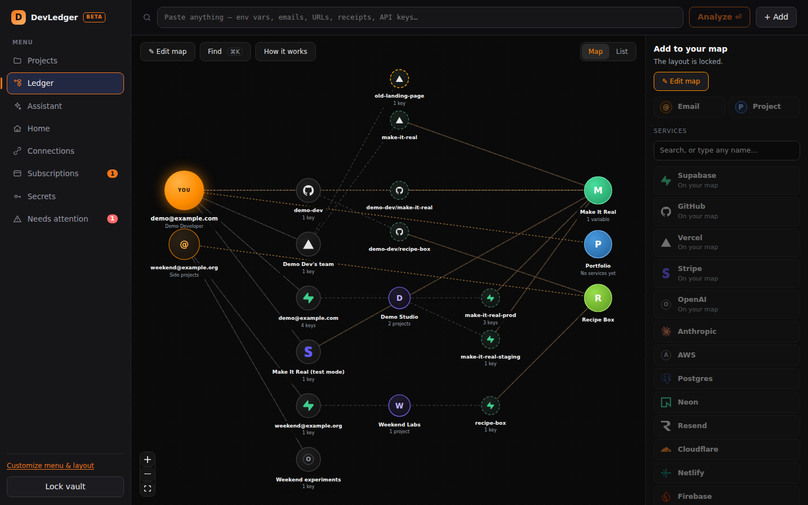

# DevLedger

**Every account, key and project a developer signs up for, on one map.**

Which email owns which GitHub, Vercel and Supabase account. Which project uses
which database. Where every API key lives, and what it all costs each month.
DevLedger keeps it in one encrypted file on your own computer.

- **Use it in your browser:** [devledger.nyttolabs.com/app](https://devledger.nyttolabs.com/app)
  keeps your own vault, encrypted with your passphrase, in your browser. No
  account and no server. The [demo](https://devledger.nyttolabs.com/demo) runs
  the same app on made-up sample data.
- **Download:** [latest release](https://github.com/jonjys/devledger/releases/latest)
  for Windows, Linux and Android. Checksums and install notes are on
  [the website](https://devledger.nyttolabs.com/#download).



**New in 0.14.1: smarter checks.** Needs attention now also flags keys
nobody has rotated in a year, free trials that start billing within a week,
and more than one paid plan with the same provider, each with a button to the
page that fixes it. The web app's vault is now sealed with Argon2id, like the
desktop app; vaults made before open as usual and are upgraded on unlock.
Android and iPhone builds no longer go missing from a release when GitHub is
slow.

**New in 0.14: make it yours.** Overview becomes Home, a page of boxes you
arrange: numbers, projects, trials, spend, needs attention, key names and notes
you write yourself. Choose which tabs the menu shows and in what order, start
from one of six templates, save your own and share it as a code. On a phone the
bar holds four tabs and More, and tables become cards. The layout is stored in
your vault. The website also has a [web app](https://devledger.nyttolabs.com/app)
that keeps its own encrypted vault in your browser, with backups you can
download, and a [page on how to check all this yourself](https://devledger.nyttolabs.com/trust).

**New in 0.13: an AI assistant that never sees a key.** Add your own Anthropic
API key and ask DevLedger to review your setup, plan the rotation of a leaked
key, or answer questions about what is connected to what. Only names and
connections are sent: never a key value or a preview of one, never a note, and
every email address is swapped for a placeholder that is put back on your
machine. "What is sent?" shows the exact text first. Details in
[`docs/SECURITY.md`](docs/SECURITY.md#the-ai-assistant).

No cloud. No account. No telemetry. DevLedger only touches the network when you
press a button: Connect or Refresh on a provider account (read requests only),
or a question to the assistant, if you switched it on.

## Installing

Every file on the release page is built by the
[release workflow](https://github.com/jonjys/devledger/actions/workflows/release.yml)
from the tagged source, and GitHub lists a SHA-256 next to each one.

**Windows.** The installer is not code-signed yet, so the first run shows
*"Windows protected your PC"*. That is about the missing signature; click
**More info → Run anyway**. To check you have the file GitHub built:

```powershell
Get-FileHash .\DevLedger_0.14.1_x64-setup.exe -Algorithm SHA256
```

and compare it with the checksum on the release page or the website.

**Linux.** `chmod +x` the `.AppImage` and run it, or install the `.deb`.
**Android.** Install the `.apk` after allowing installs from your browser.
**iPhone.** The `.ipa` is unsigned and needs a sideloading tool; see below.
There is no macOS build yet.

## Status

Version 0.14. Pre-release software that has not had an independent security
audit: the guarantees in [`docs/SECURITY.md`](docs/SECURITY.md) are the design
intent, checked by the test suite and `scripts/security-check.sh`, not the
result of external review. A forgotten passphrase cannot be recovered.

## Running it

Prerequisites: a current stable Rust toolchain (`rustup` reads
`rust-toolchain.toml`), Node 20+, and the platform's Tauri prerequisites
(on Windows, the WebView2 runtime, which ships with Windows 11).

```bash
cd apps/desktop
npm install
npm run tauri dev          # development
npm run tauri build        # Windows installers land in src-tauri/target/release/bundle/
```

`npm run tauri build` on Windows produces both an NSIS `.exe` and an MSI in
`apps/desktop/src-tauri/target/release/bundle/`. The CI workflow builds the same
artifacts on every push and attaches them to the run.

Phone builds use the same vault. The shell collapses to a bottom navigation bar
below 800px wide, so the iPhone and Android apps are the desktop app, not a
separate product.

```bash
# Android. Needs ANDROID_HOME, NDK_HOME and a JDK.
./scripts/build-android-apk.sh
# APK (arm64, installs on current phones): apps/desktop/src-tauri/gen/android/app/build/outputs/apk/

# iOS, on a Mac with Xcode:
cd apps/desktop
npm run tauri ios init -- --ci
npm run tauri ios build -- --ci --target aarch64
```

A version tag (`v*`) also builds the Android APK and the iOS app and attaches
them to the GitHub release. The Android APK installs directly (allow installs
from the browser). Apple only installs an IPA that was signed with an Apple
Developer identity, so the iPhone file is signed when `APPLE_CERTIFICATE`,
`APPLE_CERTIFICATE_PASSWORD` and `APPLE_PROVISIONING_PROFILE` are set on the
repository; otherwise the release contains an unsigned IPA that still has to be
signed before it will open on a phone.

## Layout

```
crates/devledger-core/     Security, parsing and persistence. No UI, no network.
crates/devledger-connect/  Connectors. The only crate that opens a socket.
apps/desktop/src-tauri/    Tauri v2 shell: IPC commands and capability config.
apps/desktop/src/          React + TypeScript frontend.
apps/desktop/src/web/      Website only: demo backend, web app vault, Tauri shims, landing script.
apps/desktop/web/          Website pages. Built by vite.web.config.ts, deployed by vercel.json.
scripts/security-check.sh  The invariants CI enforces on every push.
docs/                      Architecture, threat model and decision records.
```

## How it behaves

**It maps what you have actually got.** A developer accumulates several provider
accounts under different emails, each with its own organizations and projects.
DevLedger models that properly: an identity holds accounts, accounts contain
organizations, organizations contain provider resources, and your *own* projects
sit alongside, linked to the resources they use. One project can draw on a
Supabase project, a Vercel project and a Stripe account at once; one Supabase
project can serve two of your projects.

**Smart Paste is deterministic.** The same text always produces the same
analysis. Classification comes from the value itself wherever it can: a JWT's
own `role` claim decides whether something is an anon key or a service_role
key, so a credential filed under a misleading variable name is still identified
correctly. There is no model and no guessing.

**Three ways in.** Enter it by hand -- any person, address, service, login,
password or variable, with no token and no network. Paste something and
DevLedger works out what it is. Or connect a provider account and DevLedger
reads its structure directly. DevLedger only ever sends read requests; it
cannot see what a token you give it is allowed to do, so create tokens with the
narrowest scope the provider offers. Connecting happens only when you press a
button, and nothing reaches your map until you review what was found. Several accounts with the same provider stay
separate — connecting a second Supabase account never overwrites the first.

**It asks rather than assuming.** Paste a few lines naming your project, your
organization, your email and a provider URL, and DevLedger proposes the whole
chain with its reasoning attached — then asks you to confirm the parts it had to
guess. "I don't know" is a real answer: the gap is stored as a gap and listed
under **Needs attention**, never filled in with a plausible-looking placeholder.

**Nothing is written until you say so.** A paste produces a review sheet listing
what was detected, what it matches in your vault, what relations are proposed
and with what evidence, and any warnings. Each row offers Save, Change, Create
new or Skip. Cancelling discards the staged plaintext.

**Secrets stay in Rust.** Secret values are not serializable, so they cannot
cross the IPC boundary by accident. `reveal_secret` is the only command that
returns plaintext to JavaScript and it needs a deliberate click. Copy Secret and
Copy `.env` are rendered in Rust and written straight to the OS clipboard, so
the common flows never put a credential in the frontend at all. `.env` export
can be scoped to one deployment environment and refuses conflicting duplicate
names instead of silently choosing a value.

See [`docs/SECURITY.md`](docs/SECURITY.md) for the threat model and
[`docs/ARCHITECTURE.md`](docs/ARCHITECTURE.md) for how the pieces fit.

## Development

```bash
cargo fmt --all
cargo clippy --workspace --all-targets -- -D warnings
cargo test --workspace
./scripts/security-check.sh

cd apps/desktop
npm run typecheck
npm test

# The website: a landing page and the app running on in-memory sample data.
npm run dev:web            # http://localhost:1430
npm run build:web          # static site in apps/desktop/dist-web/, what Vercel serves

# Boot the built app on a virtual display and screenshot each screen.
# Linux only; needs xvfb, xdotool and imagemagick.
(cd apps/desktop && npx tauri build --no-bundle) && ./scripts/smoke-ui.sh
```
